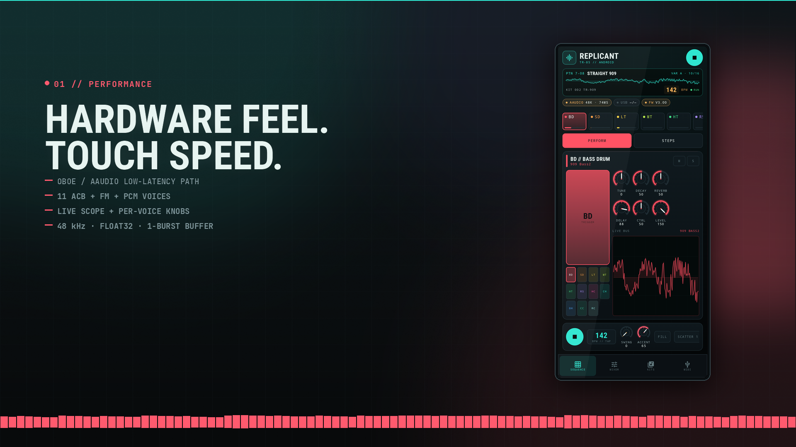
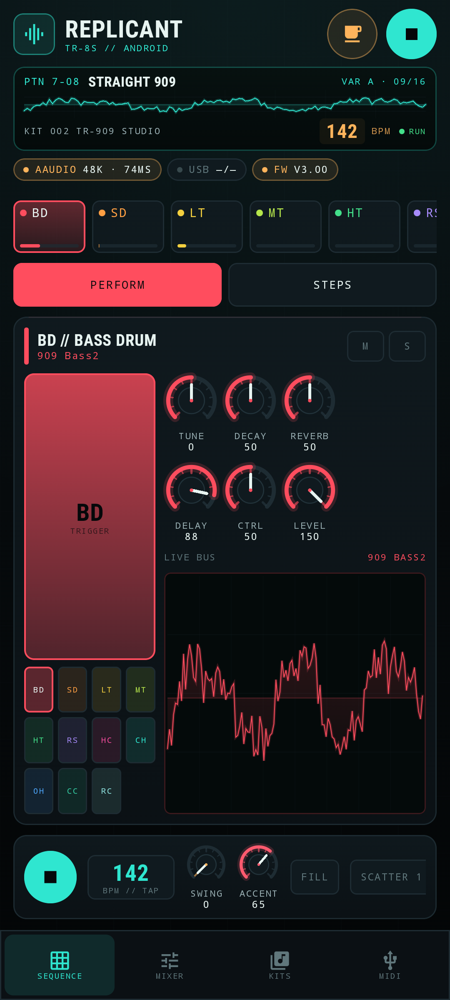
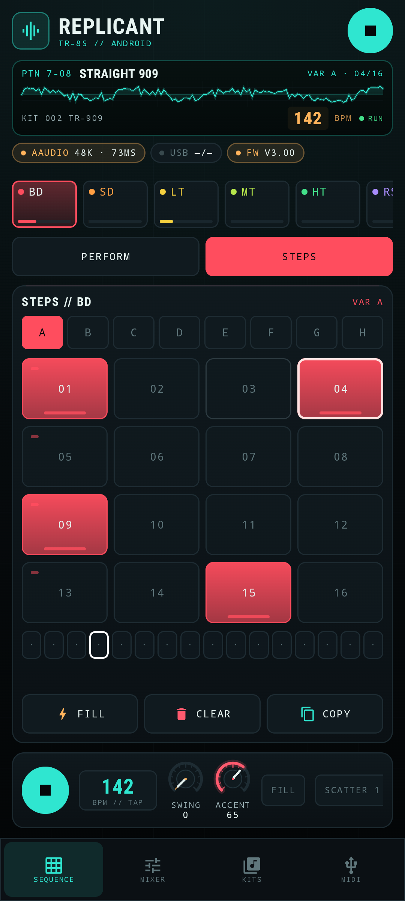
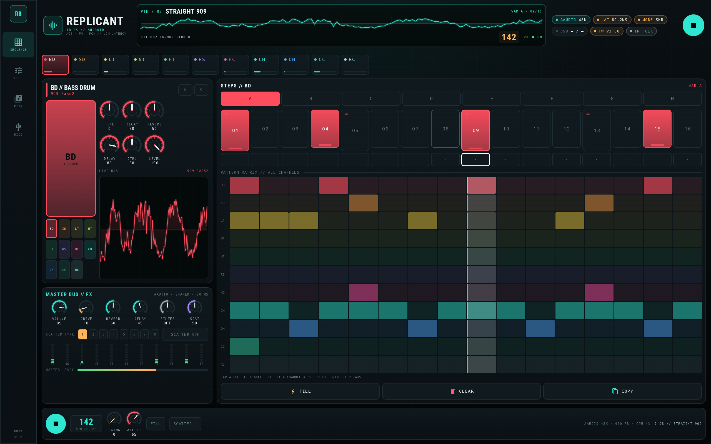
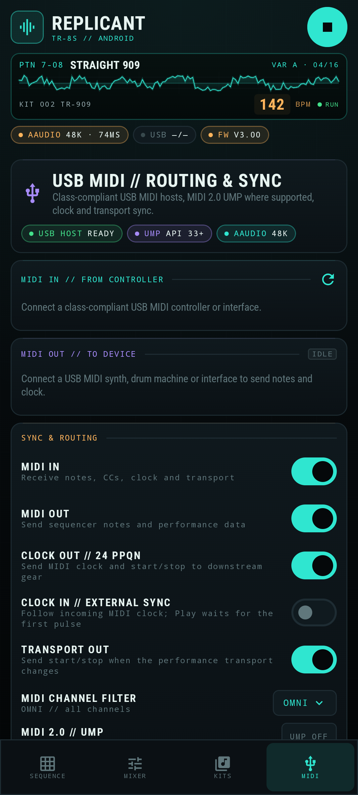

# REPLICANT TR-8S // ANDROID

<p align="center">
  <strong>A native Android rhythm performer built on the ReplicantTR8S engine.</strong><br>
  <em>Kotlin + Jetpack Compose UI · C++20 DSP · Oboe / AAudio · USB MIDI 1.0 + MIDI 2.0 · Phone + Tablet</em>
</p>

<p align="center">
  <a href="assets/replicant_tr8s_android_promo_1080p.mp4">
    
  </a>
</p>

<p align="center">
  <em>▶ Watch the 1080p promo (48 s, English) — real emulator UI + audio rendered by the native engine.</em>
</p>

<p align="center">
  <a href="https://github.com/DanimanX/ReplicantTr8sAndroid/actions/workflows/android.yml">
    
  </a>
  <a href="https://github.com/DanimanX/ReplicantTr8sAndroid/releases/latest">
    
  </a>
</p>

<p align="center">
  📦 <strong><a href="https://github.com/DanimanX/ReplicantTr8sAndroid/releases/latest">Download the Android APK (latest release)</a></strong>
</p>

<p align="center">
  ReplicantTR8S Android is free and open source. If it earns a place in your setup and you
  feel like saying thanks, you can buy me a coffee — completely optional.
</p>

<p align="center">
  <a href="https://paypal.me/DanimanX?locale.x=en_US&amp;country.x=CL">
    
  </a>
</p>

<p align="center">
  <sub><a href="https://paypal.me/DanimanX?locale.x=en_US&amp;country.x=CL">paypal.me/DanimanX</a></sub>
</p>

---

## Overview

**ReplicantTR8S Android** is an Android port of the [ReplicantTr8s](https://github.com/DanimanX/ReplicantTr8s) drum machine. The original JUCE plug-in engine has been ported to a JUCE-free C++20 core and wrapped in a modern Android application:

- **Kotlin + Jetpack Compose** for a responsive, touch-first UI.
- **Oboe** with an **AAudio** low-latency path (exclusive mode requested, shared fallback).
- **JNI** bridge with lock-free MIDI input/output queues and atomic parameter state.
- **USB MIDI** input and output, **MIDI 2.0 UMP** translation on Android 13+, 24 PPQN clock, transport sync and a live MIDI menu.
- **Adaptive layout** for phones in portrait and tablets in portrait or landscape.
- **Built-in donation button** (☕ amber control in the header) that opens the project's PayPal page.
- **Bring-your-own firmware**: import `tr8s_sys_v300.zip` or `TR8S_UP.bin` to unlock the 128 factory kits, 128 patterns and 522 tones. No proprietary firmware or factory tables are distributed with this repository.
- **Locked until firmware is imported**: the app starts silent, the transport is disabled and the UI shows a firmware gate. The engine only produces audio after a valid user-supplied image is parsed.

Once unlocked, the app runs a complete 11-channel drum engine (808 / 909 / 707 / 727 / 606 / CR-78 / FM / PCM-style voices), a 16-step sequencer with 8 variations and accent/flam programming, per-channel reverb/delay sends, a master bus with drive, filter and AIRA-style scatter, and a live scope.

---

## Feature highlights

### Sound engine

- 11 voices: `BD`, `SD`, `LT`, `MT`, `HT`, `RS`, `HC`, `CH`, `OH`, `CC`, `RC`.
- ACB-style circuit models for 808, 909, 707/626, 727, 606 and CR-78 timbres.
- 2-operator FM drum engine and preset synth/PCM-style voices.
- Per-channel `TUNE`, `DECAY`, `CTRL`, `LEVEL` (150 ceiling), `PAN`, reverb send, delay send.
- 16-step sequencer, 8 variations (`A–H`), accent row, flam substeps, shuffle, fill-in.
- 128 kits / 128 patterns / 522 tones when a TR-8S v3.00 firmware image is imported.
- No built-in kit, pattern or tone content: without an imported image the engine is silent and the transport is locked.
- Master bus: tempo-synced delay, stereo reverb, DJ filter, analog drive/limiter, 8 scatter types.

### Low latency and glitch-free audio

- **Oboe 1.9.3** output stream with `PerformanceMode::LowLatency`.
- Tries **AAudio + exclusive mode at the device's native sample rate first** (the MMAP fast path), then exclusive at 48 kHz, then shared AAudio at the native/48 kHz rate, then OpenSL ES.
- One-burst buffer when exclusive mode is granted; two bursts in shared mode, where AAudio enforces that minimum anyway.
- **Adaptive buffer**: if the device reports underruns, the driver grows the buffer one burst at a time (up to four) instead of leaving the stream permanently crackling.
- The audio callback only renders. Stream timestamps, xrun counters and buffer queries run on the UI thread, because even a short HAL query inside the callback can miss the deadline.
- Float32 stereo output, no allocations or locks in the audio callback.
- Parameter changes are atomics; step edits are atomic pattern cells; MIDI input/output uses ring buffers.
- MIDI events are timestamped against the audio clock (including output latency compensation) for tight external sync.
- The master DJ filter uses a topology-preserving (TPT) state-variable filter with block-rate coefficients; the previous Chamberlin form could go unstable at high cutoffs and fill the reverb/delay feedback with NaNs.
- Non-finite samples are dropped at every feedback boundary, denormals are flushed to zero, and the master bus self-recovers by clearing its FX state instead of passing a NaN tail through forever.
- The silent-clock fallback ticker is suspended while the Oboe callback owns the engine, and the two renderers can no longer overlap.

> Latency is device- and firmware-dependent. The emulator used for verification opened AAudio in **shared** mode with a 960-frame burst and reported roughly **74 ms**; that number is not representative of a real phone. The app surfaces the actual sample rate, API, sharing mode, buffer size and latency in the UI instead of promising a fixed figure. On real hardware, exclusive AAudio is what moves the reported figure below the ~20 ms shared-mode floor.

### USB MIDI

Open **MIDI** from the bottom bar or navigation rail:

- Enumerate class-compliant USB MIDI devices.
- Connect **MIDI IN** (device → app) and **MIDI OUT** (app → device) independently.
- **MIDI 2.0 UMP** translation on Android 13+ for UMP-capable devices, with MIDI 1.0 byte-stream fallback.
- **24 PPQN clock out**, **external clock in**, **start/stop/continue**, song position, channel filter.
- Live monitor with direction, hex bytes, human-readable description and timestamps.
- GM drum note map (notes 36–51 plus chromatic C3–A3).
- Auto-reconnect of the last used input/output.

See [docs/MIDI_USB.md](docs/MIDI_USB.md) for the full menu guide.

### Adaptive UI

- Phone portrait: bottom navigation, `PERFORM` / `STEPS` sub-views, 4×4 step grid, quick channel pads.
- Tablet portrait: navigation rail, performance + master panels beside the sequencer and all-channel matrix.
- Tablet landscape: wide dashboard with pattern matrix, master bus and transport.
- Dark hardware-inspired theme with per-channel colors, live meters, live scope and animated step pads.

---

## Screenshots

| Phone — perform | Phone — steps |
| --- | --- |
|  |  |

| Tablet — landscape | Phone — USB MIDI |
| --- | --- |
|  |  |

More: [mixer](screenshots/phone_mixer.png) · [kit library](screenshots/phone_kits.png) · [tablet portrait](screenshots/tablet_portrait.png).

---

## Download & releases

Every version tag builds and publishes an installable release from GitHub Actions:

- **APK** (`ReplicantTR8S-Android-<version>.apk`) — sideload on Android 8.0+ (arm64-v8a devices; the APK also carries x86_64 for emulators).
- **AAB** (`ReplicantTR8S-Android-<version>.aab`) — Play Store / bundletool bundle.
- **SHA256SUMS.txt** — checksums for both binaries.

Install the latest:

```bash
adb install -r ReplicantTR8S-Android-1.0.0.apk
```

Releases are produced by `.github/workflows/release.yml` on any `1.0.0`-style or
`v1.0.0` tag (and by manual dispatch). The APK is signed with the release keystore
when the `REPLICANT_KEYSTORE_BASE64` secret is configured, otherwise with the CI
debug key so it still installs. See [docs/RELEASING.md](docs/RELEASING.md).

## Build

### Requirements

- JDK 21 (AGP 8.7.3 / Gradle 8.11.1)
- Android SDK Platform 35, Build-Tools 35.0.0
- Android NDK `27.0.12077973`
- CMake `3.22.1`
- For the host DSP tests: a C++20 compiler and CMake

```bash
export ANDROID_HOME=$HOME/Android/Sdk
export JAVA_HOME=/path/to/jdk-21

./gradlew :app:assembleDebug
./gradlew :app:testDebugUnitTest
```

APK output: `app/build/outputs/apk/debug/app-debug.apk`.

Host DSP tests:

```bash
cmake -S host -B build-host -DCMAKE_BUILD_TYPE=Release
cmake --build build-host -j
./build-host/engine_tests
./build-host/render_demo assets/replicant_tr8s_android_demo.wav
```

Full instructions, including emulator screenshots and CI, are in [docs/BUILD.md](docs/BUILD.md).

---

## Firmware (bring your own)

The app does **not** embed, download or redistribute Roland firmware. Without a user-supplied image the engine is locked: the startup screen asks for firmware and no audio is produced.

1. Obtain `tr8s_sys_v300.zip` (or `TR8S_UP.bin`) from your own TR-8S v3.00 update.
2. On the **FIRMWARE REQUIRED** screen, or later in **KITS → IMPORT FIRMWARE**, select the file.
3. The app parses the POSIX TAR container, decompresses the LZSS `rpg42_init_param.bin`, and builds the kit, pattern and tone tables in memory.
4. The parsed binary is stored only in the app's private storage for subsequent launches.
5. Clearing the firmware locks the engine again and deletes the stored image.

The parser was verified during development with a user-supplied `tr8s_sys_v300.zip`; the resulting app reported **128 kits, 128 patterns and 522 tones**, and the factory pattern rendered audio through the engine. Firmware files are ignored by git.

---

## What's new in 1.0.1

- **Fixed intermittent audio crackling.** The master DJ filter went unstable at high cutoffs
  and produced NaNs; the reverb/delay feedback then kept the whole master bus corrupted.
  The filter is now a stable TPT state-variable design, non-finite samples are dropped at
  every feedback boundary, denormals are flushed, and the master bus self-recovers.
- **Lower latency on real devices.** Exclusive AAudio is attempted at the device's native
  sample rate first (avoiding a forced resampler), the buffer is one burst in exclusive mode,
  and it grows adaptively only when the device reports underruns. Stream metrics no longer
  run inside the audio callback.
- **The engine is locked until firmware is imported.** The app no longer starts a preview
  kit or pattern bank: without a user-supplied TR-8S v3.00 image the UI shows a firmware
  gate, the transport is disabled and the native engine outputs silence. This removes the
  built-in content entirely.
- Version `1.0.1` (`versionCode` `10001`).

---

## Verification

| Check | Result |
| --- | --- |
| Native host engine tests | PASS — locked and silent without firmware, audio after installing a test bank, MIDI note trigger, channel filter, transport/clock output, 24 PPQN timing, variation edits, full master-filter sweep stays finite and bounded |
| Firmware parser (user-supplied v3.00) | PASS — 128 kits, 128 patterns, 522 tones, factory pattern renders, no non-finite samples |
| Android unit tests | PASS — 14 tests: MIDI running status, realtime interleaving, SysEx skip, UMP encode/decode, model invariants |
| Android build | PASS — `assembleDebug` + `testDebugUnitTest` locally and in GitHub Actions (green run, debug APK artifact) |
| Android release executable | PASS — `assembleRelease` + `bundleRelease` produce a signed APK/AAB; version `1.0.1` (versionCode `10001`), native ABIs arm64-v8a + x86_64 |
| Release automation | Tag `1.0.1` triggers the release workflow (verified for `1.0.0`), which publishes the APK, AAB and checksums as GitHub Release assets |
| Donation button | PASS — header button (icon on phones, "DONATE A COFFEE" on tablets) launches `https://paypal.me/DanimanX` in the browser; verified from logcat |
| App on emulator | PASS — firmware gate blocks the app until import, then AAudio opens, the sequencer runs, steps edit, screenshots captured for phone/tablet |
| USB MIDI hardware | Not available in this environment. The MIDI menu, parser, UMP codec and clock engine are unit-tested; hardware validation is the next external step. |

---

## Architecture

```
Compose UI  ──  EngineController  ──  JNI  ──  C++20 Engine  ──  Oboe / AAudio
     │                 │                          │
     │                 └── MidiController ────────┼── USB MIDI 1.0 / 2.0 UMP
     │                                            │
     └── StateFlow snapshots (params, status, meters, scope)
```

- `app/src/main/java/.../audio` — JNI surface, engine lifecycle, foreground service, polling.
- `app/src/main/java/.../midi` — MIDI manager, UMP codec, running-status parser, monitor.
- `app/src/main/java/.../ui` — Compose theme, components, adaptive screens.
- `app/src/main/cpp/engine` — firmware bank, ACB voices, master bus, sequencer, lock-free MIDI rings, Oboe driver.
- `host/` — host-side engine tests and demo renderer.
- `tools/make_promo.py` — promo video generator using the real screenshots and engine audio.

Detailed signal flow and threading notes: [docs/ARCHITECTURE.md](docs/ARCHITECTURE.md).

---

## Project layout

```
app/                    Android application + native engine
  src/main/cpp/engine/  C++20 DSP, firmware parser, Oboe driver
  src/main/java/.../    Kotlin UI, MIDI, lifecycle
  src/test/             JVM unit tests
host/                   Host DSP tests and demo renderer
screenshots/            Real emulator captures
assets/                 Promo video, poster, demo audio
docs/                   Architecture, MIDI, build notes
tools/                  Promo generator
```

---

## Roadmap

- User sample import per channel (WAV/AIFF/FLAC/MP3/OGG).
- MIDI learn and per-channel MIDI note remapping.
- Bluetooth MIDI and virtual MIDI ports.
- Audio recording / export of the performance.
- Android foreground-service polish for MIDI-only background use.

---

## ☕ Support the project

ReplicantTR8S Android is free, MIT licensed and has no ads, tracking or paid tier.
If it is useful to you in the studio, at rehearsal or on stage, you can support
its development with a coffee:

<p align="center">
  <a href="https://paypal.me/DanimanX?locale.x=en_US&amp;country.x=CL">
    
  </a>
</p>

* **PayPal:** [https://paypal.me/DanimanX?locale.x=en_US&country.x=CL](https://paypal.me/DanimanX?locale.x=en_US&country.x=CL)

The same button is built into the app: the amber **☕ DONATE A COFFEE** control in
the header (icon-only on phones) opens the PayPal page in your browser.

---

## Legal

- TR-8S, TR-808, TR-909, TR-707, TR-727, TR-606 and CR-78 are trademarks of Roland Corporation. This project is not affiliated with or endorsed by Roland.
- No Roland firmware, ROM data or factory tables are included in this repository or in any build.
- The firmware parser is a clean-room runtime reader for files supplied by the user.
- The original ReplicantTr8s project is MIT licensed by DanimanX. This Android port keeps the same license.

## License

MIT — see [LICENSE](LICENSE). Third-party notices: [NOTICE](NOTICE) and [assets/licenses](assets/licenses).
